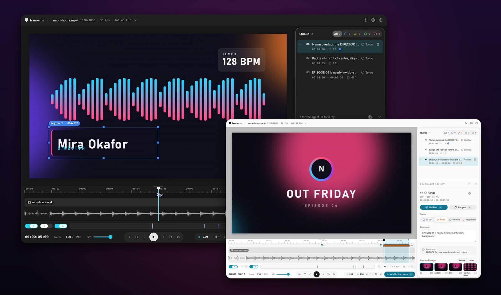
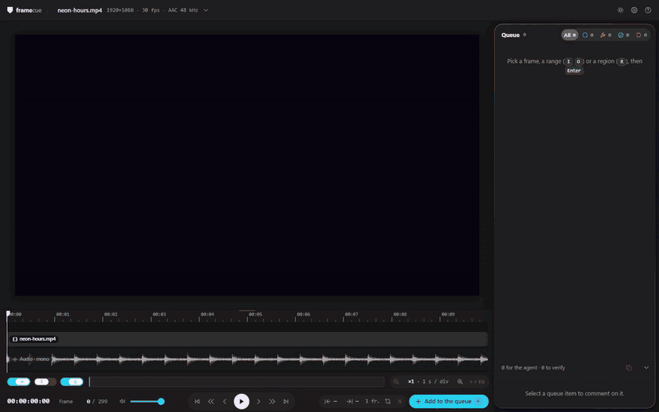
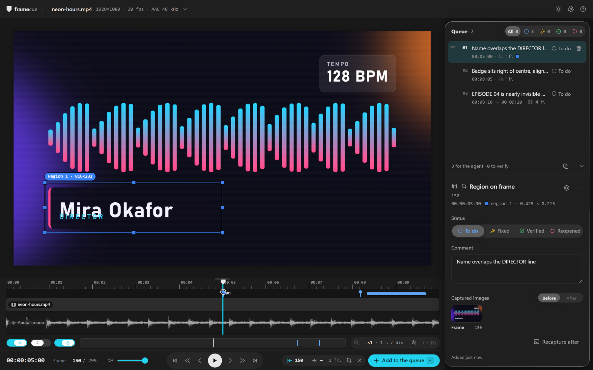
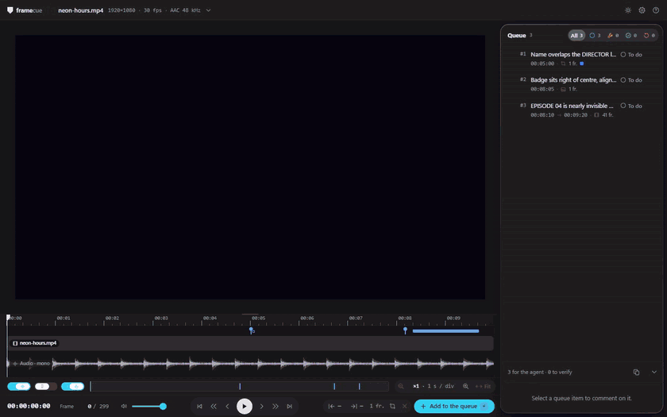
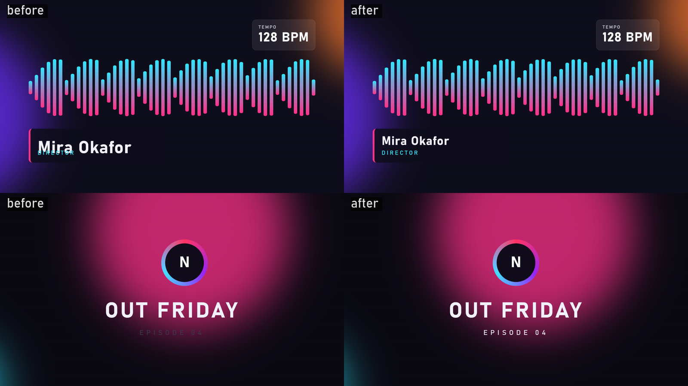
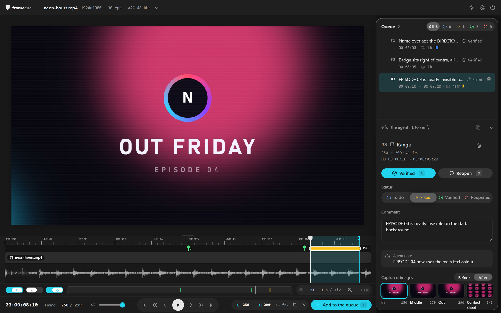

<p align="center"></p>

<h1 align="center">framecue</h1>

<p align="center">
  <a href="https://www.npmjs.com/package/framecue"></a>
  <a href="https://github.com/wewesss/framecue/actions/workflows/ci.yml"></a>
  <a href="#-licence"></a>
  <a href="#-installation"></a>
  <a href="./docs/fr/agents.md"></a>
</p>

> « Un lecteur vidéo local où vous signalez des images, des plages et des zones, et où un agent de code les corrige à partir d'une file priorisée. »

📖 [English](./README.md) · Français

[Prise en main](./docs/fr/getting-started.md) · [Lecteur](./docs/fr/player.md) · [Agents](./docs/fr/agents.md) · [Format de la file](./docs/fr/queue-format.md) · [Architecture](./docs/fr/architecture.md)

---

<p align="center">
  
</p>

## 🧠 Qu'est-ce que framecue ?

Un lecteur vidéo web qui tourne sur votre machine. Vous choisissez une image, une plage d'images ou une zone rectangulaire, vous écrivez ce qui ne va pas, et framecue le range comme un élément dans une file. Un agent de code (Claude Code, Codex, tout ce qui lit des fichiers ou parle MCP) traite cette file. Après le nouveau rendu de la vidéo, framecue affiche l'ancienne et la nouvelle image côte à côte, et vous marquez chaque correction comme vérifiée ou rouverte.

Je l'ai fait pour le motion design et les vidéos générées. Relire un rendu avec un agent de code, c'était du travail à la main : « à 0:52 le nom chevauche », l'agent corrige, je refais le rendu, puis je revérifie chaque point, souvent sur des planches contact faites à la main. Les outils que j'ai trouvés envoient une image annotée à un agent. Aucun ne garde une file avec des priorités, des plages, des statuts et une vérification après le nouveau rendu. C'est ce trou que framecue comble.

```text
lecteur ──▶ fichiers de la file ──▶ agent ──▶ nouveau rendu ──▶ avant / après ──▶ vérifié
(vous)       (.framecue/)           presse-papiers                (framecue)   └──▶ rouvert, retour à l'agent
                                    MCP
                                    plugin
```

Rien ne quitte votre machine. Le serveur écoute sur `127.0.0.1` et il n'y a aucune télémétrie.

### Avez-vous besoin de framecue ?

Peut-être pas. Si vous avez une ou deux remarques sur une vidéo, collez-les dans le chat avec un timecode et passez à autre chose. framecue devient utile quand une vidéo a beaucoup de remarques et plusieurs tours de rendu, parce que c'est là qu'on perd le fil de ce qui est corrigé, de ce qui l'est à moitié, et de ce qu'on n'a jamais revérifié.

---

## 🚀 Démarrage rapide

```sh
npx framecue ma-video.mp4
```

framecue affiche les infos de la vidéo et l'URL, et ouvre votre navigateur (`--no-open` pour l'éviter).

1. Sélectionnez ce qui ne va pas : l'image courante, une plage (`I` pour In, `O` pour Out) ou une zone (`R`, puis glissez sur l'image).
2. Appuyez sur `Entrée` pour l'ajouter à la file.
3. Écrivez un commentaire dans le panneau de droite. `Entrée` l'enregistre.
4. Confiez la file à votre agent : cliquez sur **Copier pour l'agent** (`Maj+C`) et collez, ou laissez l'agent la lire par [MCP](./docs/fr/agents.md#serveur-mcp) ou par le [plugin Claude Code](./docs/fr/agents.md#plugin-claude-code).

→ Pas à pas complet : [`docs/fr/getting-started.md`](./docs/fr/getting-started.md)

---

## 📦 Installation

| Prérequis | Version |
|---|---|
| Environnement | Node.js 22 ou supérieur, ou Bun 1.4 ou supérieur |
| ffmpeg et ffprobe | ffmpeg 5.1 ou supérieur, les deux dans le `PATH` |
| Navigateur | un Chromium, Firefox ou Safari récent |

```sh
npx framecue <video>       # sans installation
npm i -g framecue          # global
bunx framecue <video>
bun add -g framecue
```

Les commandes d'installation de ffmpeg et de Node sous Windows, macOS et Linux, ainsi que la compilation depuis les sources, sont dans [`docs/fr/getting-started.md`](./docs/fr/getting-started.md).

---

## ✨ Fonctionnalités

<p align="center">
  
</p>

<picture>
  <source media="(prefers-color-scheme: dark)" srcset=".github/assets/player-dark.png">
  <source media="(prefers-color-scheme: light)" srcset=".github/assets/player-light.png">
  
</picture>

- Trois types d'élément : une **image**, une **plage**, ou une **zone** (un ou plusieurs rectangles colorés et numérotés, sur une image ou sur une plage).
- Des images exactes. ffmpeg extrait l'image par son numéro : le PNG que l'agent reçoit est l'image que vous avez vue.
- Une **file priorisée** : glissez une ligne par sa poignée, ou appuyez sur `Alt+↑` / `Alt+↓`. Filtre par statut, avec un compteur par statut.
- Une **timeline** avec la forme d'onde audio, le zoom, l'ancrage et les repères de chaque élément.
- **Copier pour l'agent** en Markdown ou en JSONL, avec les chemins d'images absolus, et `GET /api/export` pour la même sortie en HTTP.
- Un **serveur MCP** (`framecue mcp`) et un **plugin Claude Code** avec la commande `/framecue:review`.
- **Détection du nouveau rendu** : quand le fichier vidéo change, les images des éléments corrigés sont capturées à nouveau depuis le nouveau rendu.
- Comparaison **Avant / Après**, côte à côte ou avec un volet.
- Thème clair, sombre ou système, interface en français ou en anglais, raccourcis listés dans l'aide intégrée (`?`).

→ Chaque commande et chaque raccourci : [`docs/fr/player.md`](./docs/fr/player.md)

---

## 🔁 La boucle de correction

<p align="center">
  
</p>

Quand l'agent marque des éléments corrigés, le lecteur l'affiche en direct. Quand vous refaites le rendu, framecue remarque que le fichier a changé dès qu'il cesse d'être écrit, l'analyse, et capture à nouveau les mêmes images pour chaque élément au statut **Corrigé**. La vue **Après** montre alors les nouvelles images, et vous répondez `V` (Vérifié) ou `X` (Rouvrir).

<p align="center">
  
</p>

<picture>
  <source media="(prefers-color-scheme: dark)" srcset=".github/assets/review-dark.png">
  <source media="(prefers-color-scheme: light)" srcset=".github/assets/review-light.png">
  
</picture>

| Statut | Libellé dans l'interface | Qui le fixe |
|---|---|---|
| `todo` | À faire | Tout nouvel élément commence ici. Vous pouvez y revenir depuis le sélecteur de statut. |
| `fixed` | Corrigé | L'agent, avec `mark_fixed` (seulement depuis `todo` ou `reopened`). Vous pouvez aussi le fixer à la main. |
| `verified` | Vérifié | Vous, dans le lecteur. |
| `reopened` | Rouvert | Vous, dans le lecteur. L'élément repart chez l'agent. |

---

## 🤖 Intégration des agents

La file, ce sont des fichiers simples : `.framecue/queue.jsonl` et `.framecue/frames/<id>/*.png`, à côté de la vidéo. Tout agent qui sait lire des fichiers peut s'en servir. framecue ajoute trois façons de la lui transmettre :

- **Presse-papiers.** **Copier pour l'agent** copie les éléments à faire et rouverts, par priorité.
- **MCP.** `framecue mcp` sert la file en stdio.
- **Plugin Claude Code.** Il embarque le serveur MCP et `/framecue:review`.

```text
list_items   { status? }      la file par priorité, filtrable par statut
next_item                     l'élément todo ou reopened de plus haute priorité, avec ses images
get_item     { id }           un élément en Markdown, plus ses PNG avant et après
mark_fixed   { id, note }     todo ou reopened → fixed, avec une note qui vous est montrée
```

→ Installation pour Claude Code, Claude Desktop et les autres clients : [`docs/fr/agents.md`](./docs/fr/agents.md)

---

## ⚠️ Limites connues

- **Vous seul vérifiez ou rouvrez.** Aucun outil MCP ne peut vérifier, rouvrir, réordonner ou supprimer un élément, et `mark_fixed` refuse un élément déjà corrigé ou vérifié.
- **Fréquence d'image variable.** framecue affiche un badge `VFR` et écrit un avertissement. Les numéros d'image affichés peuvent dériver, même si l'extraction des images reste exacte. Si vous le pouvez, réencodez en fréquence constante.
- **Rectangles uniquement.** Une zone est un rectangle aligné sur les axes.
- **Les timecodes sont sans drop-frame.** Le champ d'image est `HH:MM:SS:FF`, avec le nombre d'images par seconde arrondi depuis les fps.
- **Un nouveau rendu ne met à jour que les éléments corrigés.** Les éléments situés après la fin d'un rendu plus court sont ignorés, et le lecteur le signale.
- **Une file par dossier de travail.** La file n'est pas séparée par vidéo. Deux vidéos dans le même dossier partagent `.framecue`, sauf si vous donnez à chacune son propre `--dir`.
- **Les adaptateurs ne sont pas implémentés.** Les éléments ont un champ `adapter` facultatif, que rien n'écrit ni ne lit pour l'instant.

---

## 🛠️ Compilation et tests

```sh
bun install
bun run dev:server -- <video>   # API sur le port 5730, sans ouvrir le navigateur
bun run dev                     # Vite, redirige /api vers le port 5730
bun run build                   # web, CLI (dist/cli.js) et plugin
bun run check                   # Biome
bun run typecheck               # tsc --noEmit
bun test                        # tests unitaires
bun run test:node               # test de fumée de dist sous Node
bun run test:bun-dist           # le même test de fumée, lancé par Bun
```

La CI lance check, typecheck, build, les tests et les deux tests de fumée sous Ubuntu, macOS et Windows, avec Node 22 et 24.

```text
src/cli.ts       point d'entrée : le lecteur et `framecue mcp`
src/core/        file, extraction d'images, analyse, surveillance des rendus, export, verrou, pics audio
src/server/      serveur HTTP local : API JSON, flux d'événements, lecture de la vidéo
src/mcp/         serveur MCP et recherche du dossier de travail
src/web/         le lecteur React + SCSS
plugin/          plugin Claude Code : skills, .mcp.json, build embarqué
tools/           build-plugin.ts
tests/           node-smoke.mjs
```

---

## 💡 Philosophie

- Votre vidéo reste où elle est. framecue la lit et écrit un dossier `.framecue` à côté.
- Les fichiers sont l'interface. Le lecteur, le presse-papiers et MCP ne sont que des commodités posées sur `queue.jsonl` et des PNG : un agent que je n'ai jamais testé fonctionne donc aussi.
- L'agent peut dire « corrigé ». Vous seul pouvez dire « vérifié ».

---

## ❤️ Soutien

framecue est gratuit et open source. Si l'outil vous fait gagner du temps, vous pouvez le soutenir sur [GitHub Sponsors](https://github.com/sponsors/wewesss) ou [Open Collective](https://opencollective.com/miralabs-tech). Une étoile sur [wewesss/framecue](https://github.com/wewesss/framecue) ou une [issue](https://github.com/wewesss/framecue/issues) aide aussi.

---

## 📜 Licence

Sous licence [MIT](./LICENSE-MIT) ou [Apache-2.0](./LICENSE-APACHE), à votre choix.
