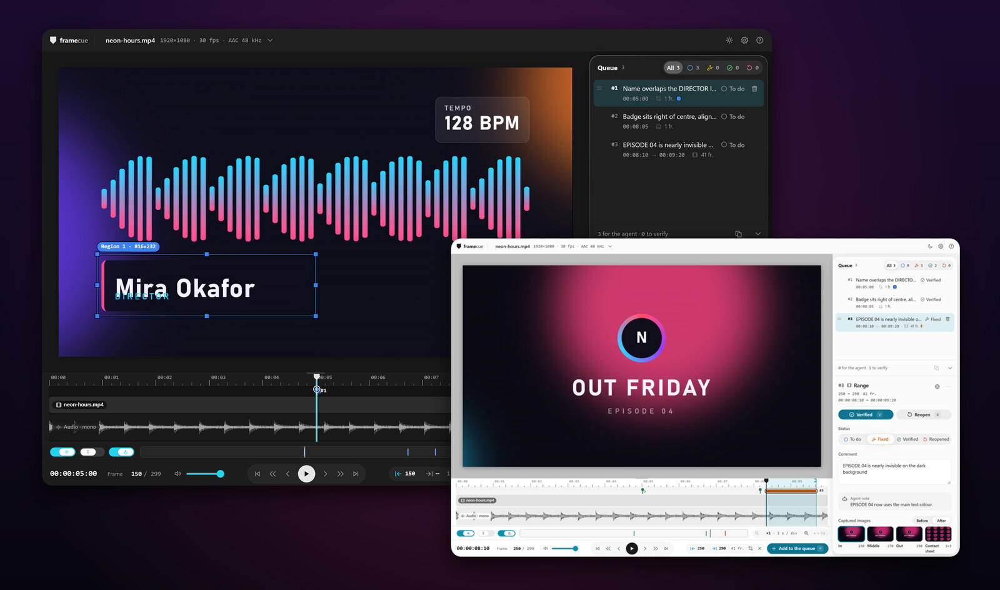
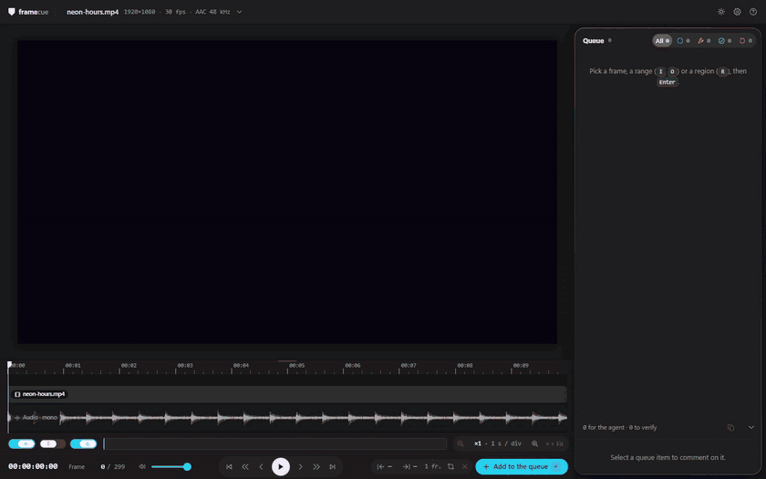
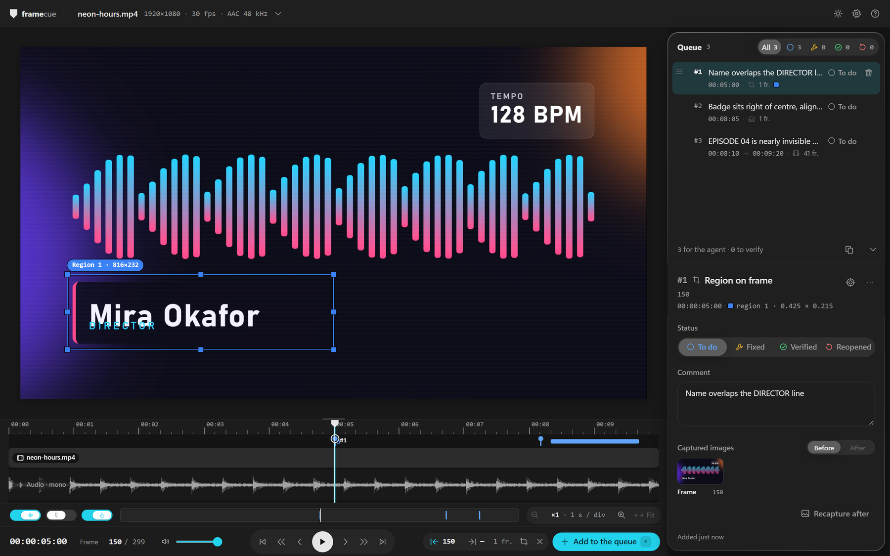
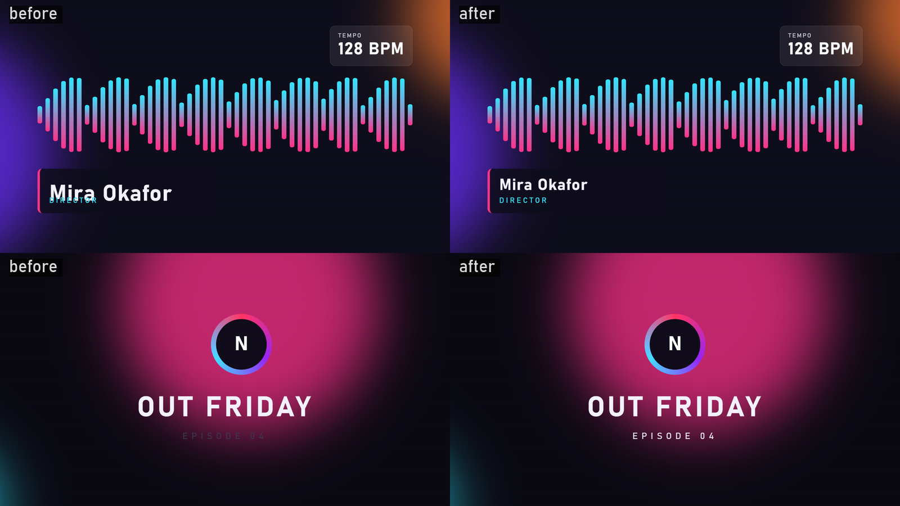
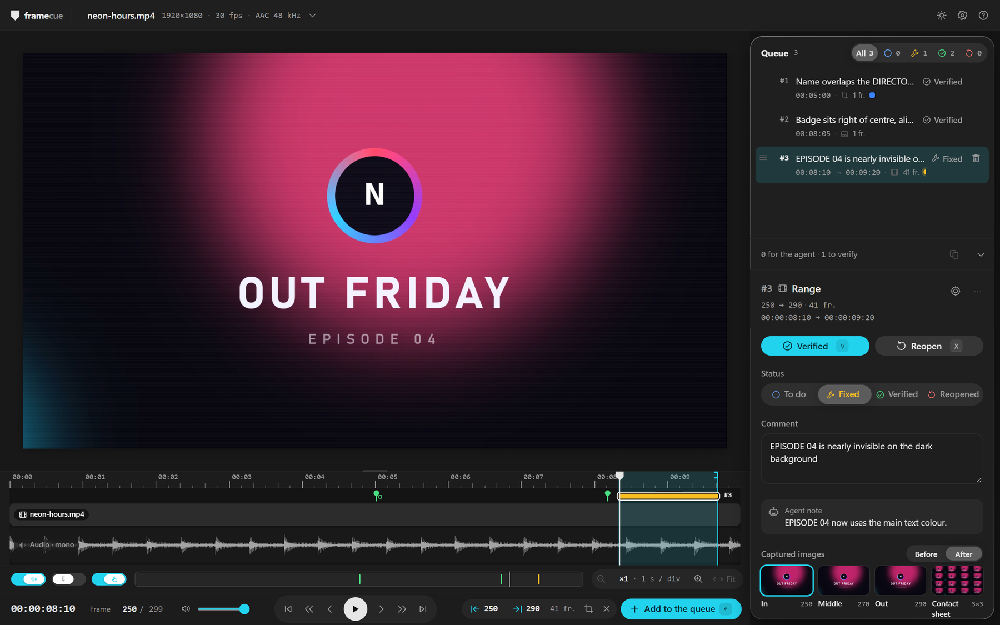

<p align="center"></p>

<h1 align="center">framecue</h1>

<p align="center">
  <a href="https://www.npmjs.com/package/framecue"></a>
  <a href="https://github.com/wewesss/framecue/actions/workflows/ci.yml"></a>
  <a href="#-license"></a>
  <a href="#-install"></a>
  <a href="./docs/en/agents.md"></a>
</p>

> "A local video player where you flag frames, ranges and regions, and a coding agent fixes them from a prioritised queue."

📖 English · [Français](./README.fr.md)

[Getting started](./docs/en/getting-started.md) · [Player](./docs/en/player.md) · [Agents](./docs/en/agents.md) · [Queue format](./docs/en/queue-format.md) · [Architecture](./docs/en/architecture.md)

---

<p align="center">
  
</p>

## 🧠 What is framecue?

A web video player that runs on your machine. You pick a frame, a range of frames or a rectangular region, write what is wrong, and framecue stores it as an item in a queue. A coding agent (Claude Code, Codex, anything that reads files or speaks MCP) works through that queue. After you re-render the video, framecue shows the old and the new frames side by side and you mark each fix as verified or reopened.

I built it for motion design and generated videos. Reviewing a render with a coding agent used to be manual: "at 0:52 the name overlaps", the agent fixes it, I re-render, then I check every point again, usually on contact sheets I made by hand. The tools I found send one annotated frame to an agent. None of them keeps a queue with priorities, ranges, statuses and a check after the re-render. That is the gap framecue fills.

```text
player ──▶ queue files ──▶ agent ──▶ re-render ──▶ before / after ──▶ verified
 (you)    (.framecue/)    clipboard                 (framecue)    └──▶ reopened, back to the agent
                          MCP
                          plugin
```

Nothing leaves your machine. The server binds to `127.0.0.1` and there is no telemetry.

### Do you need framecue?

Maybe not. If you have one or two notes on a video, paste them in the chat with a timecode and move on. framecue starts to pay off when a video has many notes and goes through several re-render rounds, because that is when you lose track of what was fixed, what was only half fixed, and what you never re-checked.

---

## 🚀 Quickstart

```sh
npx framecue my-video.mp4
```

framecue prints the video info and the URL, and opens your browser (`--no-open` to skip that).

1. Select what is wrong: the current frame, a range (`I` for In, `O` for Out), or a region (`R`, then drag on the picture).
2. Press `Enter` to add it to the queue.
3. Write a comment in the panel on the right. `Enter` saves it.
4. Hand the queue to your agent: click **Copy for the agent** (`Shift+C`) and paste, or let the agent read it through [MCP](./docs/en/agents.md#mcp-server) or the [Claude Code plugin](./docs/en/agents.md#claude-code-plugin).

→ Full walkthrough: [`docs/en/getting-started.md`](./docs/en/getting-started.md)

---

## 📦 Install

| Requirement | Version |
|---|---|
| Runtime | Node.js 22 or later, or Bun 1.4 or later |
| ffmpeg and ffprobe | ffmpeg 5.1 or later, both on `PATH` |
| Browser | a recent Chromium, Firefox or Safari |

```sh
npx framecue <video>       # no install
npm i -g framecue          # global
bunx framecue <video>
bun add -g framecue
```

Install commands for ffmpeg and Node on Windows, macOS and Linux, and a build from source, are in [`docs/en/getting-started.md`](./docs/en/getting-started.md).

---

## ✨ Features

<p align="center">
  
</p>

<picture>
  <source media="(prefers-color-scheme: dark)" srcset=".github/assets/player-dark.png">
  <source media="(prefers-color-scheme: light)" srcset=".github/assets/player-light.png">
  
</picture>

- Three kinds of item: a **frame**, a **range**, or a **region** (one or several coloured, numbered rectangles, on a frame or on a range).
- Exact frames. ffmpeg extracts the frame by its number, so the PNG the agent sees is the frame you saw.
- A **priority queue**: drag a row by its grip, or press `Alt+↑` / `Alt+↓`. Filter by status, with a count per status.
- A **timeline** with the audio waveform, zoom, snapping and the markers of every item.
- **Copy for the agent** as Markdown or JSONL, with absolute image paths, and `GET /api/export` for the same output over HTTP.
- An **MCP server** (`framecue mcp`) and a **Claude Code plugin** with a `/framecue:review` command.
- **Re-render detection**: when the video file changes, the frames of fixed items are captured again from the new render.
- **Before / After** comparison, side by side or with a wipe.
- Light, dark or system theme, English or French interface, shortcuts listed in the in-app help (`?`).

→ Every control and shortcut: [`docs/en/player.md`](./docs/en/player.md)

---

## 🔁 The fix loop

<p align="center">
  
</p>

When the agent marks items fixed, the player shows it live. When you re-render, framecue notices the file changed once it stops being written, probes it, and captures the same frames again for every item in the **Fixed** status. The **After** view then shows the new frames, and you answer `V` (Verified) or `X` (Reopen).

<p align="center">
  
</p>

<picture>
  <source media="(prefers-color-scheme: dark)" srcset=".github/assets/review-dark.png">
  <source media="(prefers-color-scheme: light)" srcset=".github/assets/review-light.png">
  
</picture>

| Status | UI label | Who sets it |
|---|---|---|
| `todo` | To do | Every new item starts here. You can set it back from the status selector. |
| `fixed` | Fixed | The agent, with `mark_fixed` (only from `todo` or `reopened`). You can also set it by hand. |
| `verified` | Verified | You, in the player. |
| `reopened` | Reopened | You, in the player. The item goes back to the agent. |

---

## 🤖 Agent integration

The queue is plain files: `.framecue/queue.jsonl` and `.framecue/frames/<id>/*.png`, next to the video. Any agent that reads files can use it. framecue adds three ways to hand it over:

- **Clipboard.** **Copy for the agent** copies the to-do and reopened items, by priority.
- **MCP.** `framecue mcp` serves the queue over stdio.
- **Claude Code plugin.** It bundles the MCP server and `/framecue:review`.

```text
list_items   { status? }      the queue by priority, optionally filtered by status
next_item                     the highest-priority item that is todo or reopened, with its images
get_item     { id }           one item as Markdown, plus its before and after PNGs
mark_fixed   { id, note }     todo or reopened → fixed, with a note shown to you
```

→ Setup for Claude Code, Claude Desktop and other clients: [`docs/en/agents.md`](./docs/en/agents.md)

---

## ⚠️ Known limits

- **Only you verify or reopen.** No MCP tool can verify, reopen, reorder or delete an item, and `mark_fixed` refuses an item that is already fixed or verified.
- **Variable frame rate.** framecue shows a `VFR` badge and prints a warning. The frame numbers shown may drift, although frame extraction stays exact. Re-encode to a constant frame rate if you can.
- **Rectangles only.** A region is an axis-aligned rectangle.
- **Timecodes are non-drop-frame.** The frame field is `HH:MM:SS:FF`, with the frame count per second rounded from the fps.
- **A re-render only updates fixed items.** Items past the end of a shorter new render are skipped, and the player says so.
- **One queue per workspace folder.** The queue is not split by video. Two videos in the same folder share `.framecue`, unless you give each one its own `--dir`.
- **Adapters are not implemented.** Items have an optional `adapter` field, and nothing writes or reads it yet.

---

## 🛠️ Build & tests

```sh
bun install
bun run dev:server -- <video>   # API on port 5730, without opening the browser
bun run dev                     # Vite, proxies /api to port 5730
bun run build                   # web, CLI (dist/cli.js) and plugin
bun run check                   # Biome
bun run typecheck               # tsc --noEmit
bun test                        # unit tests
bun run test:node               # smoke test of dist on Node
bun run test:bun-dist           # same smoke test, run by Bun
```

CI runs check, typecheck, build, the tests and both smoke tests on Ubuntu, macOS and Windows, with Node 22 and 24.

```text
src/cli.ts       entry point: the player and `framecue mcp`
src/core/        queue, frame extraction, probe, render watcher, export, lock, audio peaks
src/server/      local HTTP server: JSON API, event stream, video streaming
src/mcp/         MCP server and workspace discovery
src/web/         the React + SCSS player
plugin/          Claude Code plugin: skills, .mcp.json, embedded build
tools/           build-plugin.ts
tests/           node-smoke.mjs
```

---

## 💡 Philosophy

- Your video stays where it is. framecue reads it and writes a `.framecue` folder next to it.
- The files are the interface. The player, the clipboard and MCP are conveniences on top of `queue.jsonl` and PNGs, so an agent I never tested still works.
- The agent can say "fixed". Only you can say "verified".

---

## ❤️ Support

framecue is free and open source. If it saves you time, you can support it on [GitHub Sponsors](https://github.com/sponsors/wewesss) or [Open Collective](https://opencollective.com/miralabs-tech). A star on [wewesss/framecue](https://github.com/wewesss/framecue) or an [issue](https://github.com/wewesss/framecue/issues) helps too.

---

## 📜 License

Licensed under either of [MIT](./LICENSE-MIT) or [Apache-2.0](./LICENSE-APACHE) at your option.
