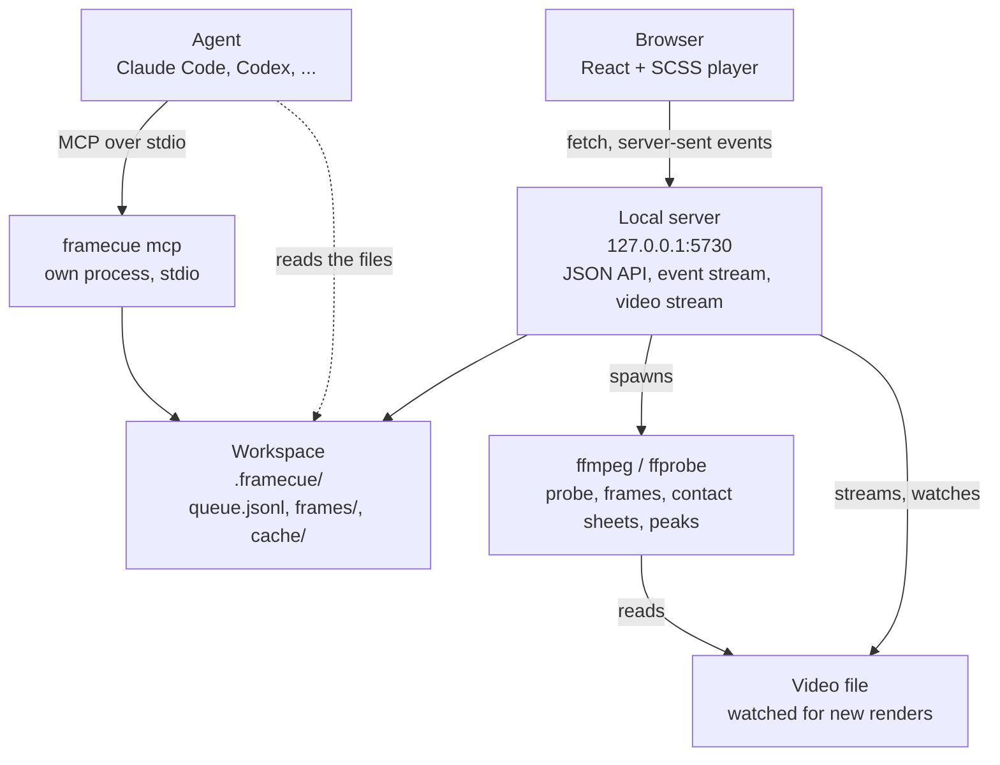

# Architecture

📖 English · [Français](../fr/architecture.md)

[← Back to the README](../../README.md)

---

framecue is a small local server, a React page it serves, and a folder of files. ffmpeg and ffprobe do all the work on the video.



## The player process

`framecue <video>` runs `src/cli.ts`, which calls `startServer` (`src/server/server.ts`):

1. It creates the workspace folder, probes the video with ffprobe, and computes the SHA-256 of the file.
2. It starts listening on `127.0.0.1`, on port 5730 or the next free one up to 5740.
3. It serves the built player (`dist/web`) and the API.
4. It watches the video file for new renders, and `queue.jsonl` for changes made by other processes.

Node's HTTP server is wrapped in `src/server/http.ts` so that the routes are plain functions from a `Request` to a `Response`.

### The API

These routes are what the player uses. They are internal to the app.

| Route | What it does |
|---|---|
| `GET /api/health` | `{ "ok": true }`. |
| `GET /api/video` | The probe result, plus the file's `sha256` and the `workspace` path. |
| `GET /api/video/stream` | The video, with `Range` support. The MIME type comes from the extension: `.mp4`, `.m4v`, `.webm`, `.mov`, `.mkv`. |
| `GET /api/audio/peaks` | The audio waveform as bytes, with the headers `X-Peaks-Rate` and `X-Peaks-Length`. 404 when there is no audio track. |
| `GET /api/items` | The queue, with a `regionsDetail` field added to each item. `?status=` filters. |
| `POST /api/items` | Creates an item and captures its frames. |
| `PATCH /api/items/:id` | Changes `comment`, `priority`, `status`, `agentNote` or `regions`. |
| `DELETE /api/items/:id` | Deletes an item and its frames. |
| `POST /api/items/reorder` | Sets the order from a list of ids. |
| `POST /api/items/:id/after` | **Recapture after**: captures the item's frames from the current render. |
| `GET /api/export` | Markdown or JSONL: see [agents](./agents.md#http-export). |
| `GET /api/frames/<id>/<name>.png` and `GET /api/frames/<id>/after-<sha8>/<name>.png` | The captured images. |
| `GET /api/events` | A server-sent events stream. |

Errors come back as `{ "error": "…" }`: 400 for a bad body, 404 for an unknown item, 409 for an invalid status transition or a frame outside a render.

The event stream carries two events. `items` says the queue changed, and `render` carries a new-render report: the new hash, the ids captured, the ids skipped, and a change of frame rate or frame count if there was one. A keep-alive comment goes out every 20 seconds.

### Staying local

- The server binds to `127.0.0.1` only.
- A request whose `Host` header is not `127.0.0.1:<port>` or `localhost:<port>` gets a 403.
- A request that is not a `GET` or a `HEAD`, and every request to `/api/events` and `/api/export`, gets a 403 if it carries an `Origin` header other than the server's own. `--dev` also accepts the Vite origin on port 5173.
- There is no telemetry.

---

## What ffmpeg and ffprobe do

| Job | How |
|---|---|
| Probe | `ffprobe -show_streams -show_format -of json`. The frame count comes from `nb_frames`, or from `-count_frames` when the container does not say. Variable frame rate is flagged when the average and nominal rates differ by more than 0.5 %, or when the first 300 packet timestamps are irregular. |
| Frames | One ffmpeg call per item with `-vf select=eq(n\,N)+eq(n\,M)…` and `-fps_mode passthrough`, so ffmpeg writes the frames with those numbers and nothing else. The result is checked: if the video is too short, the call fails and nothing is stored. |
| Contact sheets | The same `select`, then `scale=320:-2,tile=4x4`. |
| Audio waveform | `ffmpeg -map 0:a:0 -ac 1 -ar 8000 -f s16le`, reduced to a minimum and a maximum for every 40 samples, so 200 pairs per second. Cached in `cache/peaks-<sha256>-200.bin`. |

---

## Detecting a new render

`src/core/render.ts` watches the folder of the video with `fs.watch`, and re-arms the watcher if that folder is deleted and created again, which some render pipelines do. A one-second heartbeat also checks the file, in case an event was missed.

When the file's size and modification time have stayed the same for one second, and ffprobe can read it, the server computes its SHA-256. The same hash as before means nothing happens. A different hash starts a pass:

1. Probe the new file.
2. For each item in the `fixed` status, capture its frames into `frames/<id>/after-<sha8>/`, remove older `after-*` folders, and set `after` on the item.
3. If an item's frames are past the end of the new render, clear its `after` and report it as skipped.
4. Send the `render` and `items` events to the player, and print the line in the terminal.

---

## The MCP process

`framecue mcp` is a separate process, started by the agent's client. It imports the same `src/core` code, reads and writes the same files, and shares no memory with the player. The two stay consistent through the write lock described in [agents](./agents.md#concurrency), and the player notices the changes by watching `queue.jsonl`.

---

## Source layout

```text
src/
├── cli.ts                 argument parsing, `framecue <video>` and `framecue mcp`
├── core/
│   ├── types.ts           Item, Region, VideoInfo and the render events
│   ├── queue.ts           reading, writing, creating, updating, reordering items
│   ├── frames.ts          frame and contact sheet extraction
│   ├── probe.ts           ffprobe wrapper
│   ├── render.ts          new-render watcher and the after captures
│   ├── export.ts          Markdown and JSONL output
│   ├── lock.ts            the cross-process queue.lock
│   ├── peaks.ts           audio waveform
│   ├── regions.ts         region colours and pixel rectangles
│   ├── timecode.ts        frame to timecode
│   └── exec.ts, hash.ts   process spawning, SHA-256
├── server/
│   ├── server.ts          routes, watchers, events
│   └── http.ts            Node HTTP server wrapped around Request and Response
├── mcp/
│   ├── server.ts          the four tools
│   └── workspace.ts       workspace discovery
└── web/                   the React + SCSS player
    ├── App.tsx            state and shortcuts
    ├── components/        top bar, stage, timeline, queue, detail, help
    ├── timeline/, stage/  zoom, snapping and region geometry
    ├── i18n/              en.ts and fr.ts
    └── styles/            SCSS
```

The runtime dependencies are the MCP SDK, `zod` and `matchigo`.

## Build

`bun run build` runs three steps. Vite builds the player into `dist/web`. `bun build` bundles `src/cli.ts` into `dist/cli.js` for Node. Then `tools/build-plugin.ts` bundles the CLI again into `plugin/server/framecue.js` and copies `dist/web` next to it, which is the copy the Claude Code plugin runs.
