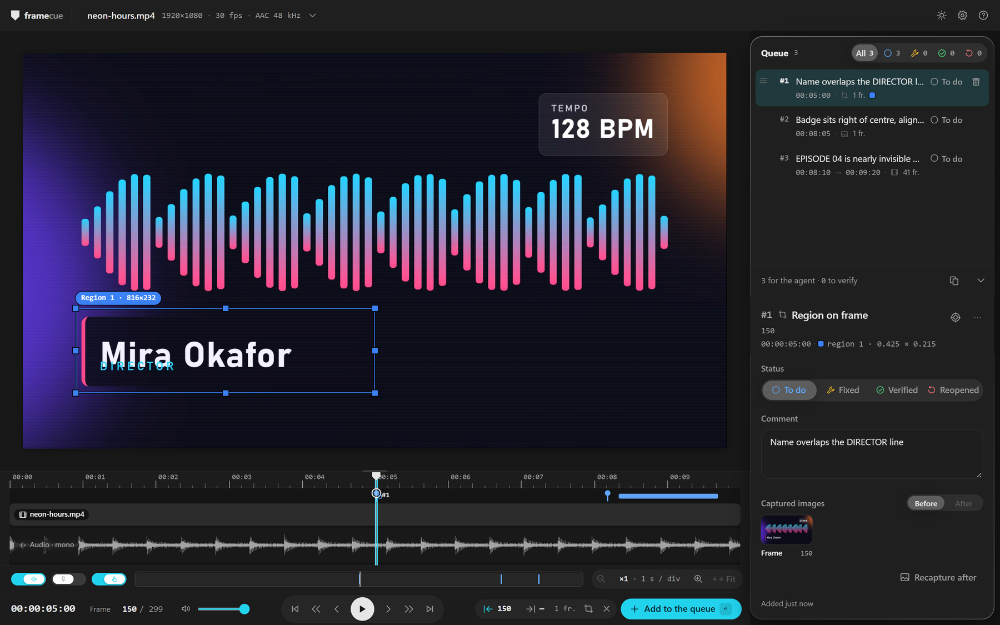
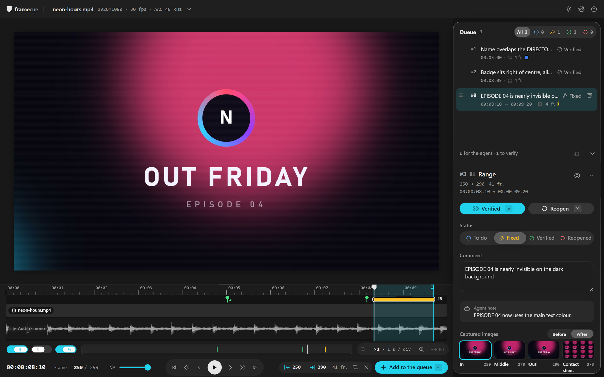

# The player

📖 English · [Français](../fr/player.md)

[← Back to the README](../../README.md)

---

<picture>
  <source media="(prefers-color-scheme: dark)" srcset="../../.github/assets/player-dark.png">
  <source media="(prefers-color-scheme: light)" srcset="../../.github/assets/player-light.png">
  
</picture>

## Layout

- **Top bar.** The file name with its resolution, frame rate and audio. Click it for the file info: path, frame size, frame rate, duration, video and audio codecs, and the path of `queue.jsonl`. On the right: the light / dark button, **Settings** and **Help**. A `VFR` badge appears when the frame rate is variable.
- **Stage.** The video frame, where you draw regions.
- **Timeline.** Playhead, the audio waveform, the In / Out range, and one marker per queue item.
- **Tools row**, under the timeline. **Audio** (show or hide the waveform), **Snapping**, **Long press**, zoom out and in with the length of one division, **Fit**, and a strip showing which part of the clip is visible.
- **Transport.** Timecode, a **Frame** field to jump to a frame, volume and mute, the transport buttons (first frame, back 10, previous, play / pause, next, forward 10, last frame), and the selection buttons: In, Out, region, clear, and **Add to the queue**.
- **Queue panel**, on the right. The queue on top, the detail of the selected item below. Drag its left edge to resize it between 320 and 400 px.

---

## Selecting what is wrong

There are three kinds of item. Pressing `Enter` (or **Add to the queue**) creates one from the current selection.

| Kind | How to select it |
|---|---|
| **Frame** | Nothing to select. The item is the frame under the playhead. |
| **Range** | Set In with `I` and Out with `O` at two different frames, with In before Out. Setting one past the other clears the other. You can also `Shift`+drag on the timeline, or drag the In and Out brackets on the ruler. |
| **Region** | Press `R`, then drag on the picture. You can draw several regions. |

A region item can sit on a single frame ("Region on frame") or on a range ("Region on range"): without In and Out it uses the current frame, with them it uses the range.

New items start in the **To do** status and go to the bottom of the queue. After you add one, the comment field has the focus.

### Regions

- Press `R` to turn region mode on or off, then drag on the picture once for each rectangle.
- Each region gets a colour and a number: blue, red, green, orange, purple, cyan, then the colours repeat. The same colour and number appear in the queue row, in the item detail and in what the agent receives.
- Drag a handle to resize a region, drag inside it to move it, and click `×` to remove it.
- Regions are stored relative to the picture, from 0 to 1, so they do not depend on the zoom.

### Stage zoom

`Ctrl`+wheel zooms the picture around the pointer. The **Fit / 100 % / 200 %** selector in the corner does the same. Outside region mode, drag to move a zoomed picture.

---

## The timeline

- Click or drag to go to an exact frame.
- The wheel zooms around the pointer, from the whole clip down to a single frame. `Shift`+wheel pans. `+` and `-` zoom around the playhead, `Shift`+`Z` fits the whole clip.
- **Snapping** (`S`) only applies while you drag. The position jumps from one ruler tick to the next (1 s, 5 frames or 1 frame, depending on the zoom), and item starts and ends, In / Out, the playhead and the clip edges win within 8 px. A plain click always lands on the exact frame. Hold `Alt` during a drag to ignore snapping.
- **Long press** (about 300 ms) zooms to frame level around the pointer, and releasing goes back. You can turn it off under the timeline.
- The top edge of the timeline resizes it, and a double-click restores the default height.
- When a status filter is on in the queue, the markers of the other items are dimmed.

---

## The queue

Each row shows its grip, its priority number (`#1` is the most urgent), the first line of the comment, the timecode (start and end for a range), the kind, the number of frames, one coloured dot per region, and its status.

- **Priority.** Drag a row by its grip, or press `Alt+↑` and `Alt+↓`. The order is saved in `queue.jsonl`, and the agent works through it from the top.
- **Filter.** The selector at the top shows **All** and one button per status, each with a count.
- **Delete.** Click the trash icon twice (the second click must come within 3 seconds), or press `Del` with the focus in the queue panel, then confirm.
- **Footer.** "N for the agent · M to verify", and the **Copy for the agent** button. See [agents](./agents.md#copy-for-the-agent).
- Clicking a row goes to the item's first frame and shows its range and regions.

### The item detail

- A header with `#<priority>`, the kind, the frames and the timecode, and one chip per region. **Go to item** and a **More actions** menu (copy the timecode, copy the item for the agent as Markdown or JSONL, go to the item, delete).
- **Status**: a selector with the four statuses. You can pick any of them.
- **Comment**: "What is wrong here?". `Enter` saves and leaves the field, `Shift+Enter` starts a new line, `Esc` discards the edit in progress. A comment also saves when the field loses the focus.
- **Agent note**: what the agent wrote when it marked the item fixed.
- **Captured images**: a frame item has one image, a range or a region over a range has **In**, **Middle** and **Out** plus a **Contact sheet**. Clicking a frame goes to it, clicking the sheet opens it enlarged.

---

## Statuses

| Status | Meaning |
|---|---|
| **To do** | Flagged, waiting for the agent. |
| **Fixed** | The agent fixed it. Check it on the new render. |
| **Verified** | You approved the fix. |
| **Reopened** | Still wrong after the fix. It goes back to the agent. |

You can set any of the four from the status selector. The agent can only mark an item **Fixed**, and only from **To do** or **Reopened**.

---

## After a re-render

  

framecue watches the folder of the video file. When the file changes, it waits until the file has stopped changing for a second and ffprobe can read it. If the content is different from the render it already knows, it counts as a new render:

1. The player reloads the video and goes back to the frame you were on.
2. For every item in the **Fixed** status, framecue extracts the same frames from the new render and stores them next to the originals.
3. A toast says **New render detected**, with the number of items to verify. If some fixed items point at frames beyond the end of a shorter render, it says how many are "outside the new render". If the frame rate or the frame count changed, it warns that frame numbers may no longer line up. **Show** filters the queue on **Fixed**.

An item with a dot labelled "After ready" has its new images. Open it and switch **Before / After** in the captured images (the After button stays disabled until the images exist). **Compare** opens a larger view, **Side by side** or **Wipe**. In the wipe, `←` and `→` move the divider, `Shift` makes the steps 10 %, and `Esc` closes the view.

<picture>
  <source media="(prefers-color-scheme: dark)" srcset="../../.github/assets/review-dark.png">
  <source media="(prefers-color-scheme: light)" srcset="../../.github/assets/review-light.png">
  
</picture>

Then **Verified** (`V`) or **Reopen** (`X`). Both buttons only appear for an item that is **Fixed** and has its After images. After your answer, the player moves to the next item waiting for a verdict. When none is left, it says **All verified**.

An item that has no After images shows **Recapture after**, which extracts its frames from the current render. It is useful when a render finished before you marked the item fixed.

---

## Settings

Open **Settings** (the gear in the top bar).

- **Keyboard navigation** (*Experimental*, off by default). Off: `Tab` navigates, and `←` / `→` step frames anywhere outside text fields. On: the arrow keys move the focus between areas of the page.
- **Theme**: **System**, **Light** or **Dark**. The button next to the gear switches between light and dark.
- **Language**: **FR** or **EN**. Without a saved choice, the browser language decides: French if it starts with `fr`, English otherwise.

The three choices are kept in the browser's local storage.

---

## Variable frame rate

framecue asks ffprobe for the frame rate. It treats the file as variable when the average and the nominal rates differ by more than 0.5 %, or when the timestamps of the first 300 packets are irregular. The `VFR` badge then appears in the top bar, and the file info says: "Variable frame rate detected by ffprobe: the displayed frame numbers may drift. Frame extraction stays exact."

---

## Shortcuts

Shortcuts do nothing while you type in a text field, and the global shortcuts ignore `Ctrl` and `Alt` combinations. The in-app help (`?`) lists the same keys.

### Playback

| Keys | Action |
|---|---|
| `Space` | Play / pause |
| `←` `→` | Previous / next frame, when the picture or the timeline has the focus. With keyboard navigation off, anywhere outside text fields. |
| `,` `.` | Previous / next frame, from anywhere |
| `Shift`+`←` `→` | 10 frames back / forward, from anywhere |
| `Home` `End` | First / last frame |
| `M` | Mute / unmute |

### Selection

| Keys | Action |
|---|---|
| `I` `O` | Set the In / Out point |
| `R` | Draw regions on the picture |
| `Enter` | Add the selection to the queue |
| `Esc` | Clear the selection (it closes the help first, if open) |

### Picture

| Keys | Action |
|---|---|
| `Ctrl`+wheel | Zoom the picture around the pointer |
| Drag | Move the zoomed picture, outside region mode |

### Timeline

| Keys | Action |
|---|---|
| Click, drag | Go to the exact frame, scrub the playback |
| Wheel | Zoom around the pointer |
| `Shift`+wheel | Pan the zoomed timeline (or drag the window in the overview) |
| `+` `-` | Zoom in / out around the playhead |
| `Shift`+`Z` | Fit the whole clip |
| `Shift`+drag | Draw an In → Out range |
| Drag the brackets | Move the In or Out point on the ruler |
| `S` | Snapping on / off |
| `Alt` while dragging | Ignore snapping for this drag |
| Long press (~300 ms) | Frame-level zoom around the pointer |
| Top edge of the timeline | Drag to resize, double-click for the default height |

### Verification

| Keys | Action |
|---|---|
| `V` | Mark the item Verified (it must be Fixed with its After images) |
| `X` | Reopen the item |
| `←` `→` in the comparison | Move the wipe, `Shift` for steps of 10 %. `Esc` closes. |

### Navigation and queue

| Keys | Action |
|---|---|
| `↑` `↓` `←` `→` | Move the focus between areas of the page (keyboard navigation on) |
| `↑` `↓` | Select the previous / next row in the queue |
| `Alt`+`↑` `↓` | Move the item up / down in the queue |
| `Del` | Delete the selected item, after a confirmation (focus in the queue panel) |
| `Shift`+`C` | Copy the to-do and reopened items for the agent, as Markdown |
| `Enter` in the comment | Save and leave the field |
| `Shift`+`Enter` in the comment | New line |
| `Esc` in the comment | Discard the edit and leave the field |
| `?` | Open / close the help |
