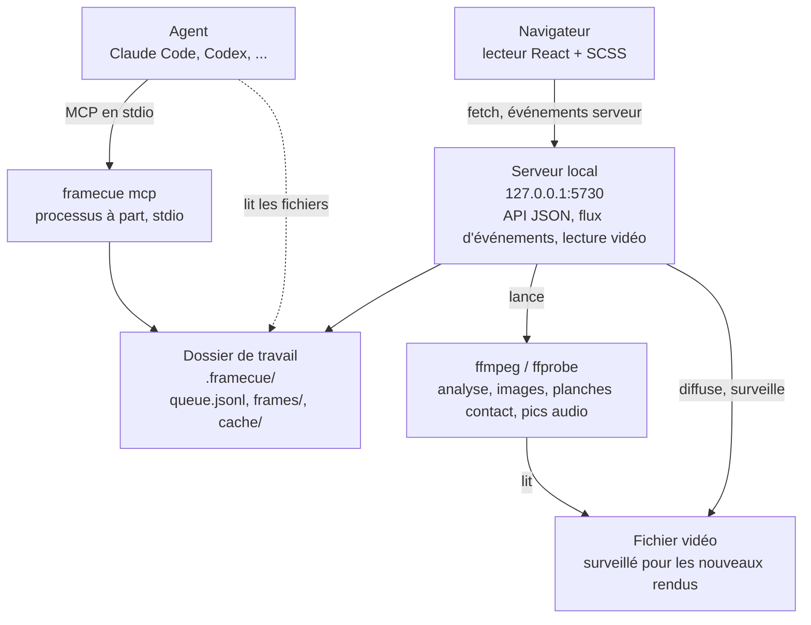

# Architecture

📖 [English](../en/architecture.md) · Français

[← Retour au README](../../README.fr.md)

---

framecue, c'est un petit serveur local, une page React qu'il sert, et un dossier de fichiers. ffmpeg et ffprobe font tout le travail sur la vidéo.



## Le processus du lecteur

`framecue <video>` lance `src/cli.ts`, qui appelle `startServer` (`src/server/server.ts`) :

1. Il crée le dossier de travail, analyse la vidéo avec ffprobe et calcule le SHA-256 du fichier.
2. Il se met à écouter sur `127.0.0.1`, sur le port 5730 ou le suivant libre jusqu'à 5740.
3. Il sert le lecteur compilé (`dist/web`) et l'API.
4. Il surveille le fichier vidéo pour détecter les nouveaux rendus, et `queue.jsonl` pour les modifications faites par d'autres processus.

Le serveur HTTP de Node est enveloppé dans `src/server/http.ts` pour que les routes soient de simples fonctions d'une `Request` vers une `Response`.

### L'API

Ces routes sont celles que le lecteur utilise. Elles sont internes à l'application.

| Route | Effet |
|---|---|
| `GET /api/health` | `{ "ok": true }`. |
| `GET /api/video` | Le résultat de l'analyse, plus le `sha256` du fichier et le chemin du `workspace`. |
| `GET /api/video/stream` | La vidéo, avec prise en charge de `Range`. Le type MIME vient de l'extension : `.mp4`, `.m4v`, `.webm`, `.mov`, `.mkv`. |
| `GET /api/audio/peaks` | La forme d'onde audio en octets, avec les en-têtes `X-Peaks-Rate` et `X-Peaks-Length`. 404 s'il n'y a pas de piste audio. |
| `GET /api/items` | La file, avec un champ `regionsDetail` ajouté à chaque élément. `?status=` filtre. |
| `POST /api/items` | Crée un élément et capture ses images. |
| `PATCH /api/items/:id` | Modifie `comment`, `priority`, `status`, `agentNote` ou `regions`. |
| `DELETE /api/items/:id` | Supprime un élément et ses images. |
| `POST /api/items/reorder` | Fixe l'ordre à partir d'une liste d'ids. |
| `POST /api/items/:id/after` | **Recapturer l'après** : capture les images de l'élément depuis le rendu actuel. |
| `GET /api/export` | Markdown ou JSONL : voir [agents](./agents.md#export-http). |
| `GET /api/frames/<id>/<name>.png` et `GET /api/frames/<id>/after-<sha8>/<name>.png` | Les images capturées. |
| `GET /api/events` | Un flux d'événements serveur (SSE). |

Les erreurs reviennent sous la forme `{ "error": "…" }` : 400 pour un corps invalide, 404 pour un élément inconnu, 409 pour une transition de statut invalide ou une image hors d'un rendu.

Le flux d'événements porte deux événements. `items` dit que la file a changé, et `render` porte le compte rendu d'un nouveau rendu : le nouveau hash, les ids capturés, les ids ignorés, et un changement de fréquence ou de nombre d'images s'il y en a eu un. Un commentaire de maintien de connexion part toutes les 20 secondes.

### Rester en local

- Le serveur n'écoute que sur `127.0.0.1`.
- Une requête dont l'en-tête `Host` n'est pas `127.0.0.1:<port>` ou `localhost:<port>` reçoit un 403.
- Une requête qui n'est pas un `GET` ou un `HEAD`, et toute requête vers `/api/events` et `/api/export`, reçoit un 403 si elle porte un en-tête `Origin` autre que celui du serveur. `--dev` accepte aussi l'origine de Vite sur le port 5173.
- Il n'y a aucune télémétrie.

---

## Ce que font ffmpeg et ffprobe

| Tâche | Comment |
|---|---|
| Analyse | `ffprobe -show_streams -show_format -of json`. Le nombre d'images vient de `nb_frames`, ou de `-count_frames` quand le conteneur ne l'indique pas. Une fréquence variable est signalée quand les fréquences moyenne et nominale diffèrent de plus de 0,5 %, ou quand les horodatages des 300 premiers paquets sont irréguliers. |
| Images | Un appel ffmpeg par élément avec `-vf select=eq(n\,N)+eq(n\,M)…` et `-fps_mode passthrough`, pour que ffmpeg écrive les images portant ces numéros et rien d'autre. Le résultat est contrôlé : si la vidéo est trop courte, l'appel échoue et rien n'est enregistré. |
| Planches contact | Le même `select`, puis `scale=320:-2,tile=4x4`. |
| Forme d'onde audio | `ffmpeg -map 0:a:0 -ac 1 -ar 8000 -f s16le`, réduit à un minimum et un maximum pour chaque tranche de 40 échantillons, soit 200 paires par seconde. Mis en cache dans `cache/peaks-<sha256>-200.bin`. |

---

## Détecter un nouveau rendu

`src/core/render.ts` surveille le dossier de la vidéo avec `fs.watch`, et réarme la surveillance si ce dossier est supprimé puis recréé, ce que font certaines chaînes de rendu. Un battement d'une seconde vérifie aussi le fichier, au cas où un événement serait manqué.

Quand la taille et la date de modification du fichier sont restées identiques pendant une seconde, et que ffprobe peut le lire, le serveur calcule son SHA-256. Le même hash que précédemment, et il ne se passe rien. Un hash différent déclenche un passage :

1. Analyser le nouveau fichier.
2. Pour chaque élément au statut `fixed`, capturer ses images dans `frames/<id>/after-<sha8>/`, supprimer les anciens dossiers `after-*` et renseigner `after` sur l'élément.
3. Si les images d'un élément sont après la fin du nouveau rendu, vider son `after` et le signaler comme ignoré.
4. Envoyer les événements `render` et `items` au lecteur, et écrire la ligne dans le terminal.

---

## Le processus MCP

`framecue mcp` est un processus séparé, lancé par le client de l'agent. Il importe le même code `src/core`, lit et écrit les mêmes fichiers, et ne partage aucune mémoire avec le lecteur. Les deux restent cohérents grâce au verrou d'écriture décrit dans [agents](./agents.md#concurrence), et le lecteur voit les changements en surveillant `queue.jsonl`.

---

## Organisation des sources

```text
src/
├── cli.ts                 lecture des arguments, `framecue <video>` et `framecue mcp`
├── core/
│   ├── types.ts           Item, Region, VideoInfo et les événements de rendu
│   ├── queue.ts           lecture, écriture, création, mise à jour, réordonnancement
│   ├── frames.ts          extraction des images et des planches contact
│   ├── probe.ts           enveloppe autour de ffprobe
│   ├── render.ts          surveillance des nouveaux rendus et captures « après »
│   ├── export.ts          sortie Markdown et JSONL
│   ├── lock.ts            le queue.lock entre processus
│   ├── peaks.ts           forme d'onde audio
│   ├── regions.ts         couleurs des zones et rectangles en pixels
│   ├── timecode.ts        image vers timecode
│   └── exec.ts, hash.ts   lancement de processus, SHA-256
├── server/
│   ├── server.ts          routes, surveillances, événements
│   └── http.ts            serveur HTTP de Node enveloppé autour de Request et Response
├── mcp/
│   ├── server.ts          les quatre outils
│   └── workspace.ts       recherche du dossier de travail
└── web/                   le lecteur React + SCSS
    ├── App.tsx            état et raccourcis
    ├── components/        barre du haut, image, timeline, file, détail, aide
    ├── timeline/, stage/  zoom, ancrage et géométrie des zones
    ├── i18n/              en.ts et fr.ts
    └── styles/            SCSS
```

Les dépendances d'exécution sont le SDK MCP, `zod` et `matchigo`.

## Compilation

`bun run build` enchaîne trois étapes. Vite compile le lecteur dans `dist/web`. `bun build` empaquette `src/cli.ts` dans `dist/cli.js` pour Node. Puis `tools/build-plugin.ts` empaquette à nouveau la CLI dans `plugin/server/framecue.js` et copie `dist/web` à côté : c'est la copie que fait tourner le plugin Claude Code.
