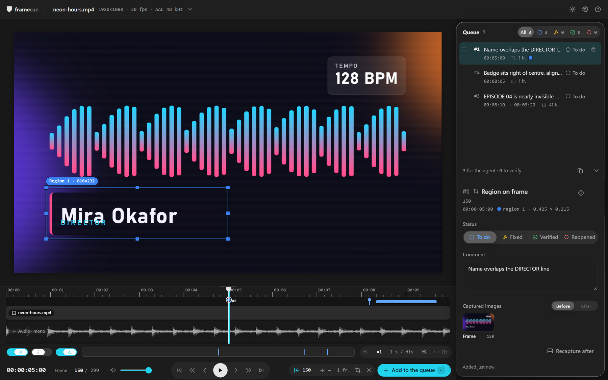
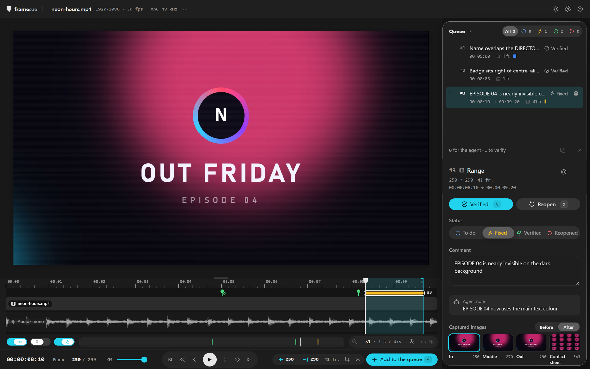

# Le lecteur

📖 [English](../en/player.md) · Français

[← Retour au README](../../README.fr.md)

---

<picture>
  <source media="(prefers-color-scheme: dark)" srcset="../../.github/assets/player-dark.png">
  <source media="(prefers-color-scheme: light)" srcset="../../.github/assets/player-light.png">
  
</picture>

## Disposition

- **Barre du haut.** Le nom du fichier avec sa résolution, sa fréquence d'image et son audio. Cliquez dessus pour les infos du fichier : chemin, taille d'image, fréquence, durée, codecs vidéo et audio, et chemin de `queue.jsonl`. À droite : le bouton clair / sombre, **Réglages** et **Aide**. Un badge `VFR` apparaît quand la fréquence d'image est variable.
- **Image vidéo.** La zone où vous tracez les zones.
- **Timeline.** La tête de lecture, la forme d'onde audio, la plage In / Out et un repère par élément de la file.
- **Ligne d'outils**, sous la timeline. **Audio** (afficher ou masquer la forme d'onde), **Ancrage**, **Appui long**, zoom arrière et avant avec la durée d'une graduation, **Ajuster**, et une bande qui montre quelle partie du clip est visible.
- **Transport.** Le timecode, un champ **Image** pour aller à une image, le volume et le son, les boutons de transport (première image, 10 en arrière, précédente, lecture / pause, suivante, 10 en avant, dernière image) et les boutons de sélection : In, Out, zone, effacer, et **Ajouter à la file**.
- **Panneau de la file**, à droite. La file en haut, le détail de l'élément sélectionné en dessous. Glissez son bord gauche pour le redimensionner entre 320 et 400 px.

---

## Sélectionner ce qui ne va pas

Il y a trois types d'élément. `Entrée` (ou **Ajouter à la file**) en crée un à partir de la sélection courante.

| Type | Comment le sélectionner |
|---|---|
| **Image** | Rien à sélectionner. L'élément est l'image sous la tête de lecture. |
| **Plage** | Placez In avec `I` et Out avec `O` sur deux images différentes, avec In avant Out. Placer l'un après l'autre efface l'autre. Vous pouvez aussi faire `Maj`+glisser sur la timeline, ou glisser les crochets In et Out sur la règle. |
| **Zone** | Appuyez sur `R`, puis glissez sur l'image. Vous pouvez tracer plusieurs zones. |

Un élément de type zone peut porter sur une seule image (« Zone sur image ») ou sur une plage (« Zone sur plage ») : sans In ni Out il prend l'image courante, avec In et Out il prend la plage.

Un nouvel élément démarre au statut **À faire** et se place en bas de la file. Juste après l'ajout, le champ de commentaire a le focus.

### Les zones

- `R` active ou désactive le mode zone, puis glissez sur l'image une fois par rectangle.
- Chaque zone reçoit une couleur et un numéro : bleu, rouge, vert, orange, violet, cyan, puis les couleurs se répètent. La même couleur et le même numéro se retrouvent dans la ligne de la file, dans le détail de l'élément et dans ce que reçoit l'agent.
- Glissez une poignée pour redimensionner une zone, glissez à l'intérieur pour la déplacer, et cliquez sur `×` pour la retirer.
- Les zones sont enregistrées relativement à l'image, de 0 à 1, donc elles ne dépendent pas du zoom.

### Zoom de l'image

`Ctrl`+molette zoome l'image autour du pointeur. Le sélecteur **Ajusté / 100 % / 200 %** dans le coin fait la même chose. Hors du mode zone, glissez pour déplacer une image zoomée.

---

## La timeline

- Cliquez ou glissez pour aller à une image exacte.
- La molette zoome autour du pointeur, du clip entier jusqu'à une seule image. `Maj`+molette fait défiler. `+` et `-` zooment autour de la tête de lecture, `Maj`+`Z` ajuste le clip entier.
- **Ancrage** (`S`) ne joue qu'en glissant. La position saute d'une graduation de la règle à la suivante (1 s, 5 images ou 1 image selon le zoom), et les débuts et fins d'éléments, In / Out, la tête de lecture et les bords du clip l'emportent à moins de 8 px. Un simple clic tombe toujours sur l'image exacte. Maintenez `Alt` pendant un glissement pour ignorer l'ancrage.
- **Appui long** (environ 300 ms) zoome au niveau de l'image autour du pointeur, et le relâcher fait revenir. Vous pouvez le désactiver sous la timeline.
- Le bord haut de la timeline la redimensionne, et un double-clic rétablit la hauteur par défaut.
- Quand un filtre de statut est actif dans la file, les repères des autres éléments sont atténués.

---

## La file

Chaque ligne montre sa poignée, son numéro de priorité (`#1` est le plus urgent), la première ligne du commentaire, le timecode (début et fin pour une plage), le type, le nombre d'images, un point coloré par zone, et son statut.

- **Priorité.** Glissez une ligne par sa poignée, ou appuyez sur `Alt+↑` et `Alt+↓`. L'ordre est enregistré dans `queue.jsonl`, et l'agent travaille en partant du haut.
- **Filtre.** Le sélecteur du haut montre **Tous** et un bouton par statut, chacun avec un compteur.
- **Suppression.** Cliquez deux fois sur l'icône de corbeille (le second clic doit venir dans les 3 secondes), ou appuyez sur `Suppr` avec le focus dans le panneau de la file, puis confirmez.
- **Pied de panneau.** « N pour l'agent · M à vérifier », et le bouton **Copier pour l'agent**. Voir [agents](./agents.md#copier-pour-lagent).
- Cliquer sur une ligne va à la première image de l'élément et affiche sa plage et ses zones.

### Le détail de l'élément

- Un en-tête avec `#<priorité>`, le type, les images et le timecode, et une pastille par zone. **Aller à l'élément** et un menu **Plus d'actions** (copier le timecode, copier l'élément pour l'agent en Markdown ou en JSONL, aller à l'élément, supprimer).
- **Statut** : un sélecteur avec les quatre statuts. Vous pouvez choisir n'importe lequel.
- **Commentaire** : « Qu'est-ce qui ne va pas ici ? ». `Entrée` enregistre et quitte le champ, `Maj+Entrée` va à la ligne, `Échap` annule la modification en cours. Un commentaire s'enregistre aussi quand le champ perd le focus.
- **Note de l'agent** : ce que l'agent a écrit en marquant l'élément corrigé.
- **Images capturées** : un élément image a une seule image, une plage ou une zone sur plage a **In**, **Milieu** et **Out** plus une **Planche** (la planche contact). Cliquer sur une image y va, cliquer sur la planche l'ouvre en grand.

---

## Les statuts

| Statut | Sens |
|---|---|
| **À faire** | Signalé, en attente de l'agent. |
| **Corrigé** | L'agent l'a corrigé. À vérifier sur le nouveau rendu. |
| **Vérifié** | Vous avez validé la correction. |
| **Rouvert** | Toujours faux après la correction. Il repart chez l'agent. |

Vous pouvez fixer n'importe lequel des quatre depuis le sélecteur de statut. L'agent, lui, ne peut que marquer un élément **Corrigé**, et seulement depuis **À faire** ou **Rouvert**.

---

## Après un nouveau rendu

  

framecue surveille le dossier du fichier vidéo. Quand le fichier change, il attend qu'il ne bouge plus pendant une seconde et que ffprobe puisse le lire. Si son contenu diffère du rendu qu'il connaît déjà, c'est un nouveau rendu :

1. Le lecteur recharge la vidéo et revient à l'image où vous étiez.
2. Pour chaque élément au statut **Corrigé**, framecue extrait les mêmes images du nouveau rendu et les range à côté des originales.
3. Une notification dit **Nouveau rendu détecté**, avec le nombre d'éléments à vérifier. Si des éléments corrigés pointent vers des images situées après la fin d'un rendu plus court, elle indique combien sont « hors du nouveau rendu ». Si la fréquence d'image ou le nombre d'images a changé, elle prévient que les numéros d'image peuvent ne plus correspondre. **Voir** filtre la file sur **Corrigé**.

Un élément avec un point « Après dispo » a ses nouvelles images. Ouvrez-le et basculez **Avant / Après** dans les images capturées (le bouton Après reste désactivé tant que les images n'existent pas). **Comparer** ouvre une vue plus grande, **Côte à côte** ou **Volet**. Avec le volet, `←` et `→` déplacent la séparation, `Maj` fait des pas de 10 %, et `Échap` ferme la vue.

<picture>
  <source media="(prefers-color-scheme: dark)" srcset="../../.github/assets/review-dark.png">
  <source media="(prefers-color-scheme: light)" srcset="../../.github/assets/review-light.png">
  
</picture>

Ensuite **Vérifié** (`V`) ou **Rouvrir** (`X`). Les deux boutons n'apparaissent que pour un élément **Corrigé** qui a ses images Après. Après votre réponse, le lecteur passe à l'élément suivant qui attend un verdict. Quand il n'en reste plus, il affiche **Tout est vérifié**.

Un élément sans images Après affiche **Recapturer l'après**, qui extrait ses images du rendu actuel. C'est utile quand un rendu s'est terminé avant que vous marquiez l'élément corrigé.

---

## Réglages

Ouvrez **Réglages** (l'engrenage dans la barre du haut).

- **Navigation clavier** (*Expérimental*, désactivée par défaut). Désactivée : `Tab` navigue, et `←` / `→` changent d'image partout hors champ texte. Activée : les flèches déplacent le focus entre les zones de la page.
- **Thème** : **Système**, **Clair** ou **Sombre**. Le bouton à côté de l'engrenage bascule entre clair et sombre.
- **Langue** : **FR** ou **EN**. Sans choix enregistré, la langue du navigateur décide : français si elle commence par `fr`, anglais sinon.

Ces trois choix sont conservés dans le stockage local du navigateur.

---

## Fréquence d'image variable

framecue demande la fréquence d'image à ffprobe. Il considère le fichier comme variable quand les fréquences moyenne et nominale diffèrent de plus de 0,5 %, ou quand les horodatages des 300 premiers paquets sont irréguliers. Le badge `VFR` apparaît alors dans la barre du haut, et les infos du fichier disent : « Fréquence d'image variable détectée par ffprobe : les numéros d'image affichés peuvent dériver. L'extraction des images reste exacte. »

---

## Raccourcis

Les raccourcis ne font rien pendant la saisie dans un champ texte, et les raccourcis globaux ignorent les combinaisons avec `Ctrl` et `Alt`. L'aide intégrée (`?`) liste les mêmes touches.

### Lecture

| Touches | Action |
|---|---|
| `Espace` | Lecture / pause |
| `←` `→` | Image précédente / suivante, quand l'image ou la timeline a le focus. Avec la navigation clavier désactivée, depuis n'importe où hors champ texte. |
| `,` `.` | Image précédente / suivante, depuis n'importe où |
| `Maj`+`←` `→` | 10 images en arrière / en avant, depuis n'importe où |
| `Début` `Fin` | Première / dernière image |
| `M` | Couper / remettre le son |

### Sélection

| Touches | Action |
|---|---|
| `I` `O` | Point d'entrée / de sortie |
| `R` | Tracer des zones sur l'image |
| `Entrée` | Ajouter la sélection à la file |
| `Échap` | Effacer la sélection (ferme d'abord l'aide, si elle est ouverte) |

### Image

| Touches | Action |
|---|---|
| `Ctrl`+molette | Zoomer l'image autour du pointeur |
| Glisser | Déplacer l'image zoomée, hors mode zone |

### Timeline

| Touches | Action |
|---|---|
| Clic, glisser | Aller à l'image exacte, faire défiler la lecture |
| Molette | Zoom autour du pointeur |
| `Maj`+molette | Faire défiler la timeline zoomée (ou glisser la fenêtre dans la vue d'ensemble) |
| `+` `-` | Zoom avant / arrière autour de la tête de lecture |
| `Maj`+`Z` | Ajuster : afficher tout le clip |
| `Maj`+glisser | Tracer une plage In → Out |
| Glisser les crochets | Déplacer le point In ou Out sur la règle |
| `S` | Ancrage on / off |
| `Alt` en glissant | Ignorer l'ancrage le temps du glissement |
| Appui long (~300 ms) | Zoom au niveau de l'image autour du pointeur |
| Bord haut de la timeline | Glisser pour redimensionner, double-clic pour la hauteur par défaut |

### Vérification

| Touches | Action |
|---|---|
| `V` | Marquer l'élément Vérifié (il doit être Corrigé avec ses images Après) |
| `X` | Rouvrir l'élément |
| `←` `→` dans la comparaison | Déplacer le volet, `Maj` pour des pas de 10 %. `Échap` ferme. |

### Navigation et file

| Touches | Action |
|---|---|
| `↑` `↓` `←` `→` | Déplacer le focus entre les zones de la page (navigation clavier activée) |
| `↑` `↓` | Sélectionner la ligne précédente / suivante dans la file |
| `Alt`+`↑` `↓` | Monter / descendre l'élément dans la file |
| `Suppr` | Supprimer l'élément sélectionné, après confirmation (focus dans le panneau de la file) |
| `Maj`+`C` | Copier les éléments à faire et rouverts pour l'agent, en Markdown |
| `Entrée` dans le commentaire | Enregistrer et quitter le champ |
| `Maj`+`Entrée` dans le commentaire | Aller à la ligne |
| `Échap` dans le commentaire | Annuler la modification et quitter le champ |
| `?` | Ouvrir / fermer l'aide |
